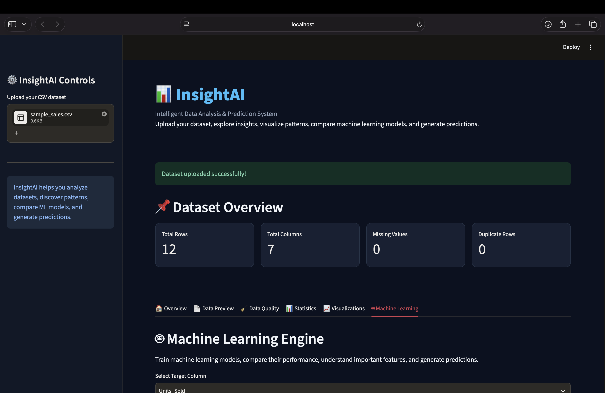
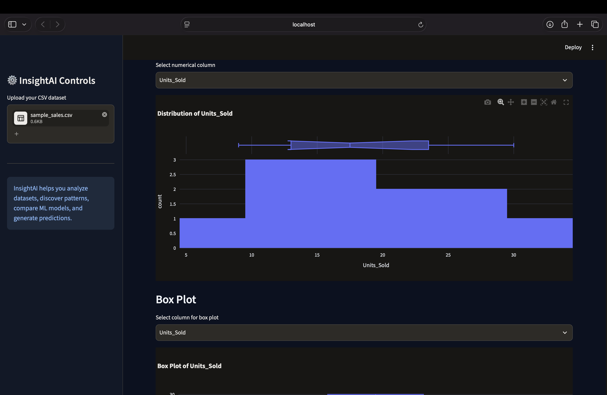
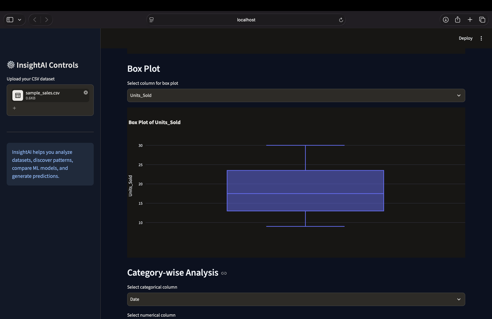
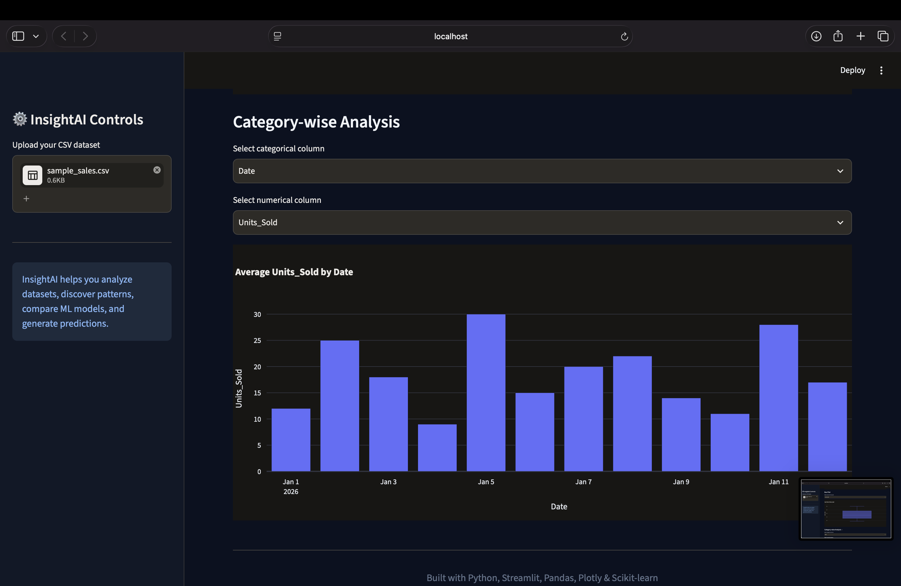
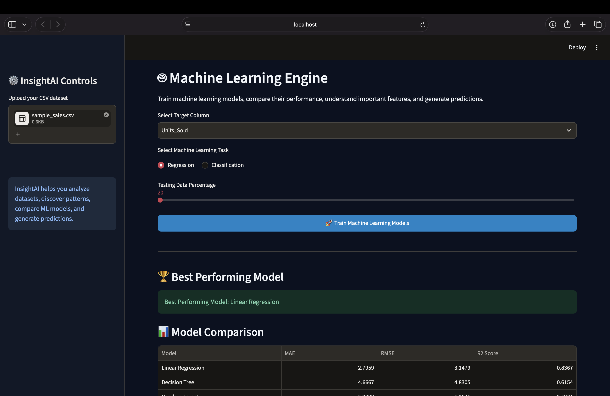
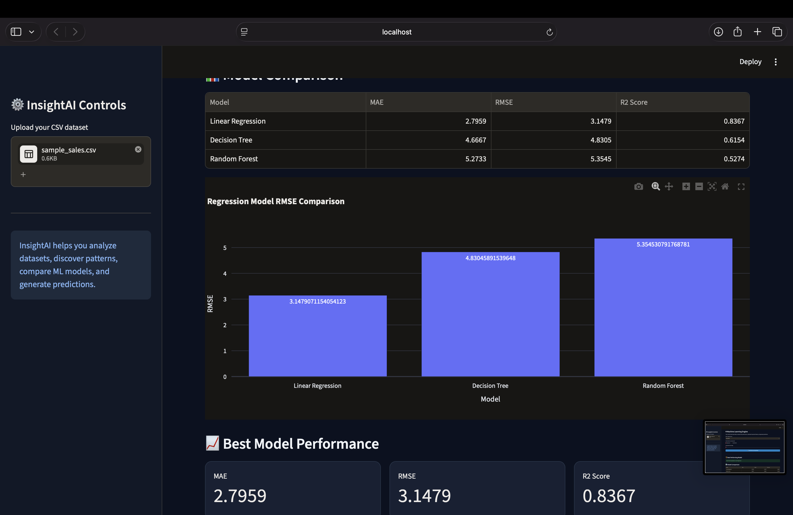
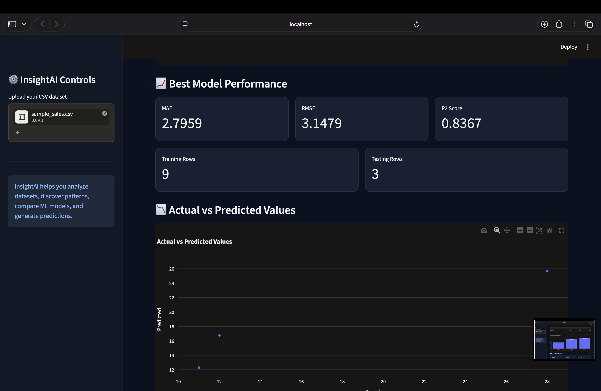
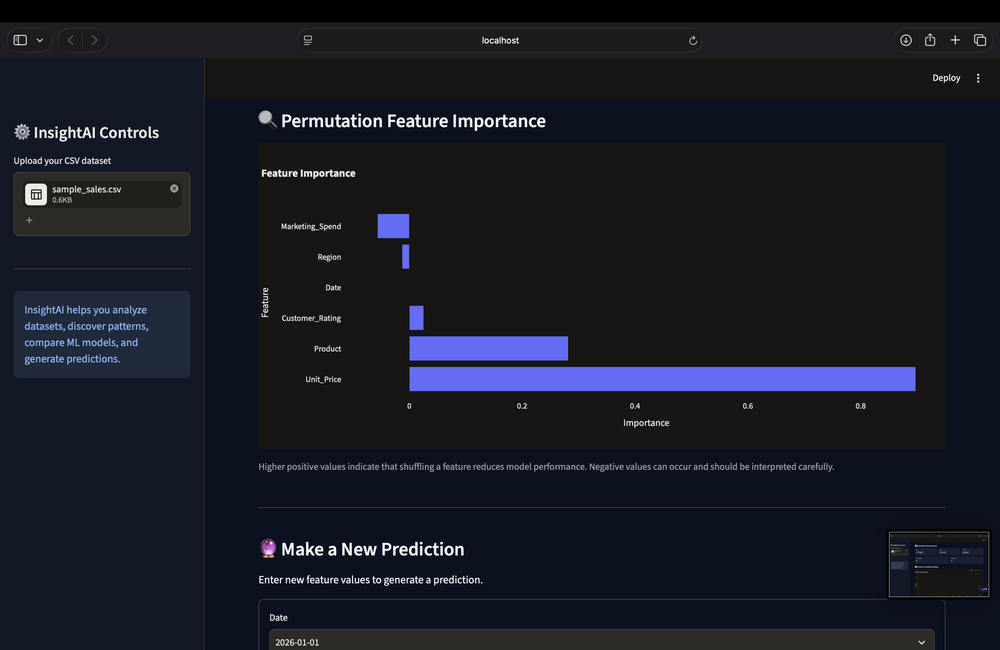
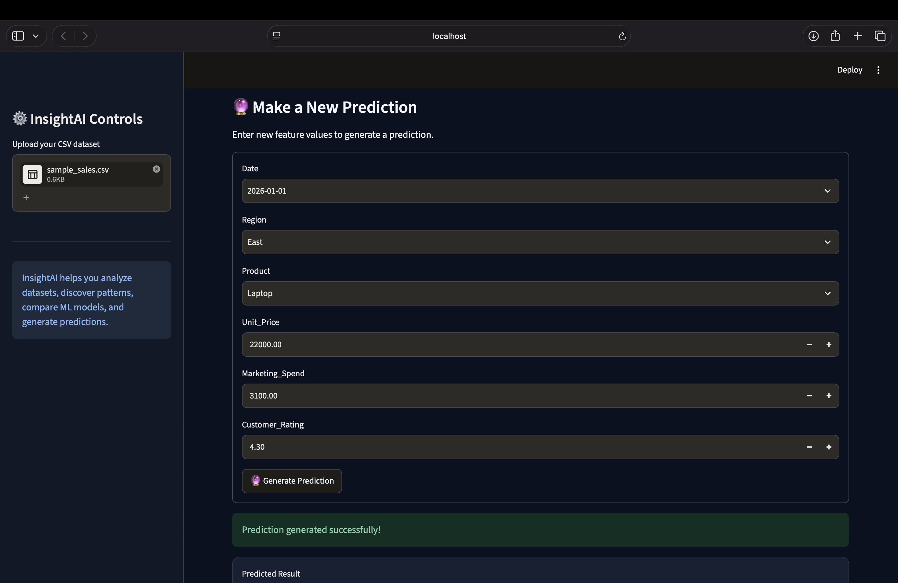

# 📊 InsightAI – Intelligent Data Analysis & Prediction System

InsightAI is an interactive data analysis and machine learning application built using Python and Streamlit. It helps users explore CSV datasets, visualize patterns, compare machine learning models, and generate predictions through a simple dashboard.

## 🚀 Features

- **Dataset Upload:** Upload CSV datasets.
- **Data Analysis:** View dataset structure, statistics, missing values, and duplicate records.
- **Data Visualization:** Generate interactive histograms, box plots, bar charts, and correlation heatmaps.
- **Data Quality:** Identify missing values and duplicate records.
- **Machine Learning:** Train regression and classification models.
- **Model Comparison:** Compare Linear Regression, Decision Tree, Random Forest, and Logistic Regression where applicable.
- **Performance Evaluation:** View Accuracy, Precision, Recall, F1 Score, MAE, RMSE, and R² Score.
- **Feature Importance:** Analyze model features using permutation importance.
- **Prediction System:** Enter new feature values and generate predictions.

## 🛠️ Technologies Used
- Python
- Streamlit
- Pandas
- NumPy
- Plotly
- Scikit-learn

## 🤖 Machine Learning Models

**Classification**
- Logistic Regression
- Decision Tree
- Random Forest

**Regression**
- Linear Regression
- Decision Tree
- Random Forest

## 📁 Project Structure

```text
InsightAI/
├── app.py
├── modules/
│   └── model_training.py
├── sample_data/
├── assets/
├── README.md
├── requirements.txt
└── .gitignore
```

## ⚙️ Installation and Setup

### 1. Clone the repository

```bash
git clone https://github.com/harini020306/InsightAI.git
cd InsightAI
```

### 2. Create a virtual environment

```bash
python3 -m venv venv
```

### 3. Activate the environment

```bash
source venv/bin/activate
```

### 4. Install dependencies

```bash
pip install -r requirements.txt
```

### 5. Run the application

```bash
python -m streamlit run app.py
```

Open the local URL displayed in your terminal.

## 📊 Sample Datasets

Sample datasets are provided for testing classification and regression workflows.

## 🎯 Project Objective

The objective of InsightAI is to make basic data analysis and machine learning workflows accessible through an interactive application without requiring users to write machine learning code.

## Sample Datasets

Two sample datasets are included to test the application:

| Dataset | Type | Description |
|---|---|---|
| `sample_classification.csv` | Classification | Iris flower species prediction |
| `sample_sales.csv` | Regression | Sales units prediction |

Upload either CSV file through the application to explore its analysis and machine learning features.

## Application Screenshots

### 1. Dashboard Overview



### 2. Dataset Analysis



### 3. Data Preview



### 4. Data Quality



### 5. Statistics



### 6. Data Visualizations



### 7. Machine Learning



### 8. Model Comparison



### 9. Prediction Results



## 👩‍💻 Author

**Harini K**

Final-Year Electronics and Communication Engineering Student

GitHub: [harini020306](https://github.com/harini020306)

---

*Built with Python, Streamlit, Pandas, Plotly, and Scikit-learn.*
